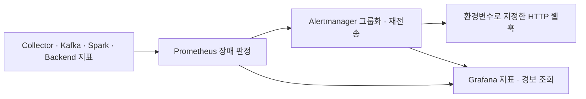

# 파이프라인 장애 알림 EC2 검증

2026-11-23 서울 리전의 `m7i.xlarge` 3대(각 4 vCPU·16GiB)에서 실제 TCP 연결을 차단하고,
운영 Prometheus 규칙과 Alertmanager를 거쳐 실험용 HTTP 웹훅 수신기에 발생·복구 알림이
모두 도착하는 것을 확인했다. 이 문서는 **알림 경로 검증** 기록이다.
전체 EC2 장애·부하·호스트 재시작 실험의 완료를 뜻하지 않는다.

## 구성

Grafana의 `WITW 장애 감지와 전달 상태` 대시보드와 Prometheus/Alertmanager 데이터 소스를
자동 등록했다. 경보 판정은 Prometheus가 담당하며 Grafana에서 같은 규칙을 중복 생성하지 않는다.
Grafana Alerting이 사용하는 규칙 API, 대시보드의 PromQL 12개, Grafana 프록시를 통한
Alertmanager 상태·경보 API가 실제로 응답하는 것을 확인했다. 브라우저 육안 검수는 수행하지 않았다.
실험 Grafana는 app 노드에서 CPU 0.25·메모리 384MiB로 제한하고 루프백 포트에만 노출했다.

## 실제 장애와 관측 결과

Collector에 입력 100건을 보관한 뒤 Toxiproxy로 Kafka TCP 경로를 차단했다.
고정 NLP 결과를 사용하고 LLM API는 호출하지 않았다.
운영 규칙의 `outbox 최장 대기 > 900초`, `for: 2분`, 수집·평가 주기 15초,
Alertmanager `group_wait: 30초`, `group_interval: 5분`을 유지했다.

| 관측 항목 | 실측 |
|---|---:|
| 장애 주입 → 첫 firing 웹훅 관측 | 1,071.005초 (약 17분 51초) |
| TCP 복구 → outbox 100건 ACK 완료 | 128.430초 (약 2분 8초) |
| outbox 해소 → resolved 웹훅 관측 | 170.774초 (약 2분 51초) |
| 첫 firing 수신 시각 | 2026-11-23 20:43:01 KST |
| resolved 수신 시각 | 2026-11-23 20:48:01 KST |

웹훅 수신기를 0.5초마다 독립 관측한 monotonic clock 기준이다.
TCP 복구 제어기는 별도 1초 폴링으로 firing을 1,071.754초에 관측했다.
두 시각을 같은 측정값으로 혼용하지 않는다. 경보 수신 후 TCP 경로를 복구했으며,
모든 ACK가 완료된 후 실제 resolved HTTP POST도 수신했다.

`promtool test rules`는 지연 조건 이전의 미발생, 발생과 해소,
Collector/Backend/Alertmanager 수집 중단 및 웹훅 실패 규칙 검사를 통과했다.
알림 설정 단위 검사 3개와 Linux EC2 지원 검사 11개도 통과했다.

## 발견한 설정 오류와 검증 범위

EC2용 설정 파일을 일괄 0600으로 제한하면서 Prometheus의 공개 설정 파일까지
비특권 컨테이너가 읽지 못하는 오류를 발견했다. 로그를 보존하고 해당 파일만 0644로 수정했다.
Prometheus는 20:39:24 KST에 기동했으며, outbox 15분 임계값 도달 전에 수집을 시작했다.
초기 약 14분은 Prometheus 관측 공백이 있으므로 전체 실험 구간을 연속 관측했다고 주장하지 않는다.
배포 생성기의 권한을 수정하고 Linux 회귀 검사와 실험 시작 전 전체 scrape 대상 준비 확인을 추가했다.

실제 운영 채널 주소는 설정하지 않았다. 확인한 것은 실제 EC2 서비스에서 실험용 HTTP 수신기까지의
전달이다. 운영 연결은 환경 파일의 `ALERT_WEBHOOK_URL`에 Alertmanager JSON을 받는 주소를
지정하고 [설정 반영 절차](PIPELINE_RELIABILITY.md)를 실행한다.
Slack/Mattermost 전용 incoming webhook은 서비스별 수신 설정 또는 변환기가 필요하다.
HTTP 수신 성공이 사람의 열람을 보장하지는 않는다.
Prometheus/Alertmanager 호스트 자체의 중단까지 알리려면 별도 호스트의 외부 생존 감시가 필요하다.

## 증거

실험 ID: `witw-rel-20261123-105044-35b97a`.
요약 원본은 `bigdata/reliability/results/ec2-alerting-20261123/`에 저장했다.

- `grafana-verification.json`: 실제 Grafana API 연결·12개 쿼리·발생/복구 수신 기록
- `notification-lifecycle.json`: 독립 관측 시각과 원본 웹훅 payload
- `network-observation.json`: TCP 장애와 복구·ACK 완료 시각
- `scope.json`: 환경·초기 오류·미검증 범위
- `evidence-sha256.json`: 위 4개 파일의 SHA-256

전체 실험 원본 회수와 실험 자원 제거는 기존 EC2 실험 완료 절차에서 이어 수행한다.
