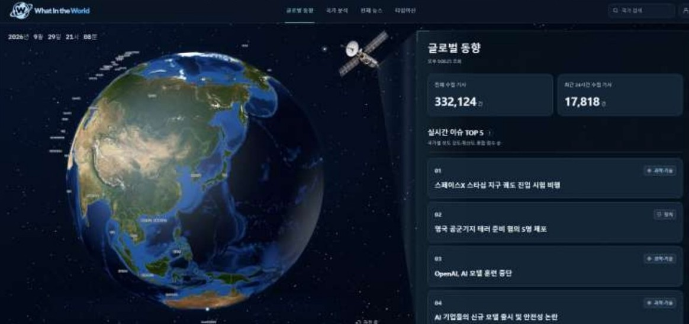
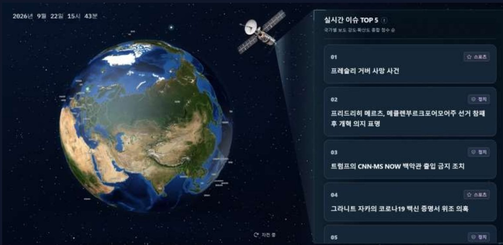
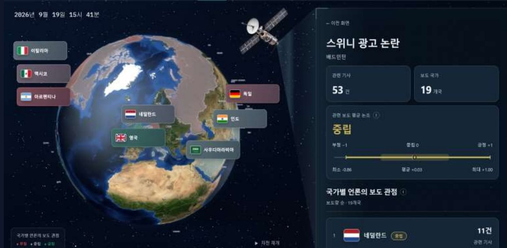
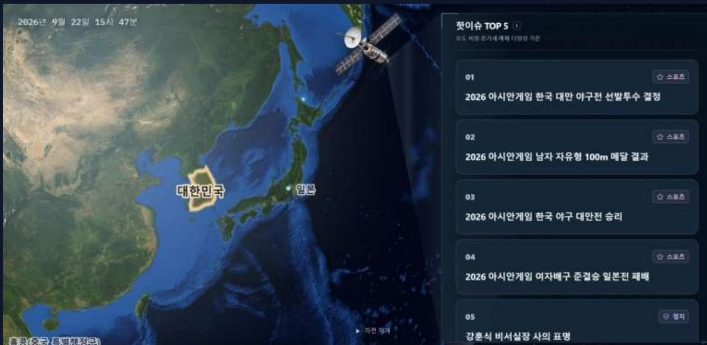

<p align="center">
  
</p>

# What In the World 🌏

> **세계의 이슈를, 나라별 시선으로** — 47개국 1,225개 언론사의 기사를 이슈로 묶고, 나라마다 어떤 논조로 보도하는지 3D 지구본 위에서 비교하는 서비스


“반도체 주식이 왜 떨어졌지?”, “국내에는 이런 기사가 뜨는데 해외는 어떨까?” — 뉴스를 읽다 떠오른 질문에서 시작했습니다. What In the World는 같은 사건을 각 나라가 어떻게 바라보는지 한눈에 보여줍니다.

## 🖥 화면

<table>
  <tr>
    <th colspan="3">메인 화면 · 글로벌 동향</th>
  </tr>
  <tr>
    <td colspan="3" align="center"></td>
  </tr>
  <tr>
    <th>글로벌 이슈 랭킹</th>
    <th>국가별 논조 비교</th>
    <th>국가별 핫이슈 랭킹</th>
  </tr>
  <tr>
    <td align="center"></td>
    <td align="center"></td>
    <td align="center"></td>
  </tr>
</table>

## ✨ 주요 기능

- **글로벌 이슈 랭킹** — 47개국 기사를 이슈 단위로 묶고, 국가별 1차 점수(보도 비율·증가 속도·언론사 수·확산 정도)와 글로벌 2차 점수를 합산한 계층형 스코어링으로 실시간 순위를 매깁니다.
- **국가별 논조 비교** — 한 이슈를 나라마다 긍정·중립·부정으로 비교하고, 국가별 언론사 보도 관점을 함께 보여줍니다.
- **국가별 핫이슈 랭킹** — 3D 지구본에서 국가를 고르면 그 나라가 가장 주목하는 이슈를 보여줍니다.
- **과거 시점 기사 조회** — 원하는 시점으로 돌아가 당시의 이슈와 기사를 다시 볼 수 있습니다.
- **이슈 클러스터링** — 임베딩 유사도 0.93 이상이면 기존 이슈에 병합하고, LLM으로 같은 사건인지 한 번 더 판별해 “같은 군집, 다른 사건”을 걸러냅니다.
- **소셜 로그인·메일 구독** — OAuth 로그인과 관심 이슈 메일 구독·실시간 알림을 제공합니다.

### 숫자로 보는 프로젝트

| 수집 국가 | 수집 언론사 | 20만 건 분산 처리 | 논조 모델 경량화 |
| :---: | :---: | :---: | :---: |
| 5개국 → **47개국** | 430개 → **1,225개** | 1시간 59분 → **39분** (2노드) | 기사당 31ms → **10ms** |

## 🛠 기술 스택

| 영역 | 기술 |
| --- | --- |
| Frontend | React 18, Vite, Three.js(3D 지구본), flag-icons, Nginx |
| Backend | Java 21, Spring Boot 4.1, Spring Batch, Spring Security, Spring Kafka, Spring Mail, springdoc-openapi |
| 데이터 | PostgreSQL, Flyway, Redis(세션) |
| 빅데이터 파이프라인 | Collector(RSS·Sitemap), Apache Kafka, Apache Spark, Hadoop HDFS |
| NLP·AI | NLP Worker(multilingual-e5-base 임베딩), 논조 분류 모델(mDeBERTa NLI 선생님 → mmBERT-small 학생 5종 지식 증류), vLLM(Qwen 계열 LLM, 번역·동일 사건 판별) |
| 인프라·모니터링 | Docker Compose, AWS EC2, GPU 서버, GitLab CI, Prometheus, Grafana Alloy·Loki·Grafana |

자세한 설계는 [`DOCS`](DOCS) 폴더(분산 파이프라인, 이슈 스코어링, 성능 측정, ERD, API 명세)에 정리했습니다.

## 🤝 협업 규칙

### 커밋 메시지

```text
[타입]: [제목]

- [간단한 설명]
```

예시: `feat: 회원 관리 기능 추가`

| type | description |
| --- | --- |
| feat | 주요 기능 관련 (추가, 변경) |
| fix | 버그 수정 |
| refact | 기능 변화를 제외한 코드 리팩토링 / 코드 스타일 변경 등 |
| docs | 문서/주석의 변경사항 |
| config | 환경 설정 관련(의존성, ci/cd 등) |
| chore | 기타등등 (파일 디렉토리 변경, 패키지 변경) |
| test | 테스트 코드 관련 |

### 브랜치

하나의 작업 단위마다 브랜치를 만듭니다. 예) 기능 개발 → `feature/login`, 문제 수정 → `hotfix/login-api-error`

| Branch | description |
| --- | --- |
| master | 라이브 서버에 제품으로 출시되는 브랜치 |
| develop | 개발 브랜치 |
| feature | 추가 기능 개발 브랜치 |
| release | 다음 버전 출시 준비 브랜치 |
| hotfix | master 브랜치 버그 수정 브랜치 |

### PR

- 기능 단위로 PR을 올리고, 최소 1명에게 승인받은 뒤 머지합니다(권장).
- 코드 리뷰를 원하는 부분이 있다면 어떤 고민·리뷰를 받고 싶은지 PR 메시지에 적습니다.
- 제목은 `feat: ~한 기능 추가`, `fix: ~ 문제 수정` 형식을 따르고, 본문에 작업 내용·이미지·지라 링크(`Resolves: S15P21D203-번호`)를 남깁니다.

자세한 내용은 [CONTRIBUTING.md](CONTRIBUTING.md)를 참고하세요.
