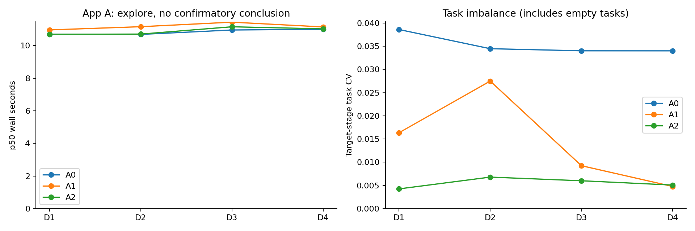
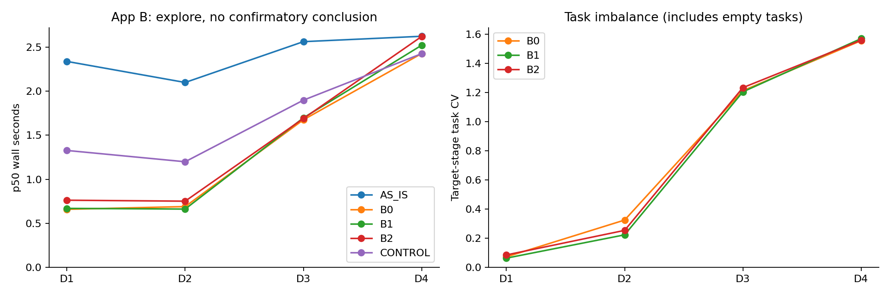

# EC2 실행 전 로컬 미니 검증 보고서

작성 기준: 2026-11-24, Asia/Seoul. 원시 실측만 사용했다. EC2 유료 자원, 본실험 720회 및 통합 C는 실행하지 않았다. 운영 파일과 데이터는 변경하지 않았으며 기존 실험은 보존했다.

## 판단

**로컬에서 A/B 본실험 코드의 실행 가능성·정합성·기본 계측은 통과했다.** 성능상 승자와 운영 적용 효과는 아직 확정할 수 없다. 실제 EC2 부팅·배포·네트워크·720회 반복은 별도 검증 대상이다. 통합 C의 서비스 배포/E2E fixture/측정 실행기는 미완성이며 A/B 이후 추가 구현이 필요하다.

|검증 실행|측정 횟수(워밍업 제외)|결과|
|---|---:|---|
|A-quick-v1|12|동일 결과, Executor 2×2 Core, 연산 4 Task, 실패 Task 0|
|B-quick-executor-cal-warm|20|동일 결과, Executor 2×2 Core, 연산 4 Task, 실패 Task 0|
|A-explore-v2|36|동일 결과, Executor 2×2 Core, 연산 4 Task, 실패 Task 0|
|B-explore-v3|60|동일 결과, Executor 2×2 Core, 연산 4 Task, 실패 Task 0|

최종 Quick 32회와 탐색 96회를 주 근거로 사용했다. A의 CSV 저장 메모리 개선은 별도 A-quick-append-check 3회로 재검증했다. 비교군별 2회 워밍업은 원시에 남기되 위 수와 통계에서 제외했다.

## 실험 환경과 정합성

프로젝트 Spark 4.2.0 Docker 이미지, Python 3.10.12, numpy 1.26.4, sklearn 1.6.1, scipy 1.15.3, Java 21을 사용했다. Driver heap1536MiB/container3GiB/CPU1, Worker당 heap2GiB/container4GiB/CPU2, Master512MiB/CPU0.5다. 원본 production 함수의 SHA와 라이브러리 버전을 Driver/Executor에서 확인했다. 실제 설정·이미지 ID는 각 environment.json과 인접 containers.json에 저장했다.

A는 각 4,000건의 기사 ID·할당 issue·출력 payload·미분류·최고 유사도·누락/중복을 비교했다. B는 각 2,000건을 테마 내 동일 순서로 처리하고 입력 ID·군집 멤버 집합·미분류·대표 기사·centroid·confidence를 원본 Driver 참조와 비교했다. 동일 테마를 쪼개지 않았고 계획한 파티션과 실제 TaskContext ID가 일치했다. 유사도 12자리, centroid/confidence 10자리 정규화 계약을 사용했다.

입력 4파티션 eager localCheckpoint로 생성 lineage를 끊고 timer 안의 대형 synthetic literal 전달을 방지했다. 원본 9열 payload를 유지했다. B0/B1/B2는 같은 RDD API이며 A0 대 A1/A2의 추가 Python Shuffle 경로 차이는 전략 비용에 포함했다.

## 탐색 실측

각 셀 n=3이며 단위는 초다. p95와 신뢰구간은 소표본 참고치다. A의 기준은 A0, B 주요군의 기준은 B0다. Driver 기준군을 B0 대비 speedup과 함께 해석할 때 기준을 혼동하지 않는다.

|실험|분포|전략|p50 s|p95 s|대상 Task CV|
|---|---|---:|---:|---:|
|A|D1|A0|10.6963|10.7451|0.039|
|A|D1|A1|10.9615|11.0039|0.016|
|A|D1|A2|10.6931|11.2110|0.004|
|A|D2|A0|10.6862|11.1642|0.034|
|A|D2|A1|11.1581|11.3354|0.027|
|A|D2|A2|10.7049|11.2096|0.007|
|A|D3|A0|10.9559|12.8948|0.034|
|A|D3|A1|11.4359|13.2558|0.009|
|A|D3|A2|11.1532|13.2356|0.006|
|A|D4|A0|10.9982|11.1204|0.034|
|A|D4|A1|11.1447|11.2388|0.005|
|A|D4|A2|11.0253|11.3832|0.005|
|B|D1|AS_IS|2.3378|2.5855|비해당|
|B|D1|B0|0.6590|0.6690|0.072|
|B|D1|B1|0.6694|0.6999|0.063|
|B|D1|B2|0.7621|0.8776|0.085|
|B|D1|CONTROL|1.3271|1.5786|비해당|
|B|D2|AS_IS|2.0987|2.1123|비해당|
|B|D2|B0|0.6897|0.7297|0.325|
|B|D2|B1|0.6616|0.7785|0.223|
|B|D2|B2|0.7511|0.7873|0.254|
|B|D2|CONTROL|1.1988|1.4159|비해당|
|B|D3|AS_IS|2.5621|2.8884|비해당|
|B|D3|B0|1.6752|1.7726|1.212|
|B|D3|B1|1.6971|1.7032|1.205|
|B|D3|B2|1.6895|1.7358|1.233|
|B|D3|CONTROL|1.8979|2.1651|비해당|
|B|D4|AS_IS|2.6231|2.7072|비해당|
|B|D4|B0|2.4269|2.4700|1.556|
|B|D4|B1|2.5213|2.8496|1.570|
|B|D4|B2|2.6208|2.6807|1.559|
|B|D4|CONTROL|2.4259|2.5543|비해당|

A D3에서 A2의 Task CV는 0.034→0.006로 줄었지만 p50은 10.956→11.153초로 늘었다. 기사 ID 기반 초기 배치가 이미 후보 비용을 여러 Task에 섞으므로 A0의 불균형이 작고, 재배치의 추가 집계·Shuffle을 회수하지 못할 수 있다. A2가 항상 더 빠르다는 근거는 없다.

B D4는 전체 2,000건을 같은 테마로 유지해야 하므로 계산 가능한 Task가 하나이고 나머지 3개는 비어 있다. B1/B2도 이 의존성을 없앨 수 없다. 심한 편향 D3도 큰 테마 하나가 임계 경로를 지배하므로 기사 수/비용 LPT만으로 완전 균형을 만들 수 없다. 균등 D1에서는 기본 hash도 충분히 균형적일 수 있어 커스텀 전략의 이득을 가정할 수 없다.

AS_IS→CONTROL은 반복 collect 감소, CONTROL→B0는 Executor 실행·분산 배치와 데이터 이동의 차이를 보여준다. 같은 로컬 Docker CPU quota이지만 물리 서버 간 네트워크는 없으므로 순수 병렬화 효과를 EC2 수치로 단정하지 않는다.

## 오버헤드 검증

A0의 측정 구간에는 1 Job/4 Task, A1/A2에는 추가 집계와 재분배로 2 Job/12 Task가 관측됐다. A1/A2의 Shuffle은 대략 90.8MB 수준이고 추가 집계는 대략 0.09~0.11초다. 계획 자체는 밀리초 규모지만 전체 추가 경로를 포함해야 한다. B 주요군은 같은 Shuffle 구조로 비교한다. 정확한 조건별 값은 summary.csv/enriched_runs.csv 및 원시 Event Log를 사용한다.

Job·Stage·Task, Shuffle read/write/fetch wait, JVM deserialize/result serialization, GC/spill, Task별 시간·CV, kernel wall/CPU, cgroup CPU/메모리/네트워크를 기록했다. 병렬 Task 시간 합을 wall에서 빼지 않았다. JVM CPU는 Python CPU 전체가 아니며 cgroup Worker CPU에 daemon도 포함된다. Scheduler residual은 순수 scheduler 비용이 아니다. 250ms 샘플과 RSS 누적 peak의 한계는 설계서에 명시했다.

정상 선택 실행에서 실패 Task·재시도·Executor 소실·OOM 이벤트가 없었다. 외부 Kafka/PG/HDFS/LLM I/O는 제외했고 timer 밖의 준비·참조 검증·저장은 비용 외삽의 전체 컨테이너 시간에 포함했다.

## 비용 모델

실제 두 Executor에서 4개 동시 Task로 8개 전용 워밍업을 제외한 144표본을 수집했다. 독립 모델 검증 MAE: 선형 0.1829초, 제곱 0.0304초, 실측 보간 0.0232초다. 선택은 `empirical`이며 holdout 탐색 입력은 보정에 사용하지 않았다.

초기 Driver 보정(B-explore-v1), Executor 초기화가 일부 포함된 보정(B-explore-v2)도 삭제하지 않았다. 최종 주 분석은 전용 워밍업을 제외한 B-explore-v3만 사용한다. 이는 보정 절차 수정이며 이전 결과를 합쳐 표본 수를 늘리지 않는다. 모델은 합성 데이터 밀도·CPU·동시 실행 환경에 의존하며 EC2에서 재보정해야 한다. HDBSCAN을 O(n²)이라고 결론내리지 않는다.

## 실패 보존과 검증 범위

A-explore-v1은 약 3,826.6초의 동시 자원 샘플 공백 뒤 두 Executor heartbeat가 끊겨 localCheckpoint가 유실됐다. OOM kill은 0이었다. 원시 CSV/Event Log/실패 정보를 보존했고 불완전한 실행 전체를 주 분석에서 제외했다. 원인을 VM/PC 정지로 확정하지는 않는다. 정상 A-explore-v2를 별도 run ID로 다시 실행했다. 이전 clustering_benchmark 결과도 그대로 보존했다.

실험 계약 단위 테스트 8개, 원본 issue_* 테스트 25개, Python 컴파일 및 CloudFormation cfn-lint 검증을 실행했다. 운영 기준 파일 12개의 SHA256 보존은 source_unchanged.json에서 확인한다. 이는 기존 사용자 변경분을 포함한 시작 시점 대비이며 원격 저장소와 같다는 의미는 아니다.

현재 증거로 확인할 수 있는 것은 합성 입력의 연산 정합성과 미니 계측이다. 실제 운영 Kafka 6파티션과 murmur2 입력, 실제 기사 밀도·후보 갱신, EC2 물리 통신 및 C 배치 경계는 검증하지 않았다. 비용 모델의 승리·통합 효과·최적 파티셔닝 채택도 확정하지 않았다.

## EC2 시간·예산 및 다음 승인

서울 m7i.xlarge 1대+m7i.large 2대, gp3 80GB, Head IPv4 1개 합계 $0.5107/시간이다. A/B 주720+별도기준240회에 대한 로컬 전체 시간 외삽은 2.21시간이며 EC2 실측이 아니다. 준비·Quick·분석과 상단 C 2시간 예약을 더한 시나리오는 2.6~7.9시간, 약 2,047~9,223원이다. 1달러=1,400원·VAT10%, 상단 예비비3,000원을 가정했다.

10시간 자동 정지 시간 기준과 예비비를 합친 계획 비용은 약 10,865원이다. 예산30,000원보다 작지만 비용 보장 한도는 아니다. 정지 뒤 EBS는 계속 과금되므로 결과 회수 후 스택을 제거한다. 실제 EC2 Quick 시간으로 본실험 시작 전 예산을 다시 검증한다.

이 단계에서 사용자 승인이 필요한 이유는 요청서의 “유료 인프라 생성 전 사용자 승인” 조건이다. 승인 전에는 deploy의 계획 출력·오프라인 검증만 수행했다. 승인 후 A/B EC2 Quick→예산 재확인→30회 본실험을 진행하고, 통합 C는 독립 효과 확인 및 실행기 완성 후 진행한다.

## 원시 자료와 재현

- [코드 및 실행 방법](../README.md), [설계](DESIGN.md), [운영 코드 분석](CODE_ANALYSIS.md)
- [전체 탐색 표](../results/explore-analysis/MEASUREMENTS.md), [요약 CSV](../results/explore-analysis/summary.csv), [paired CSV](../results/explore-analysis/paired.csv)
- [A 원시 CSV](../results/A-explore-v2/runs.csv), [A Event Log](../results/A-explore-v2/spark-events/)
- [B 원시 CSV](../results/B-explore-v3/runs.csv), [B Event Log](../results/B-explore-v3/spark-events/)
- [비용 근거와 가정](../results/cost-analysis/COST_ESTIMATE.md), [인프라 실행/회수](../infra/README.md)
- [실패 제외 기록](../results/A-explore-v1/EXCLUDED.json)
